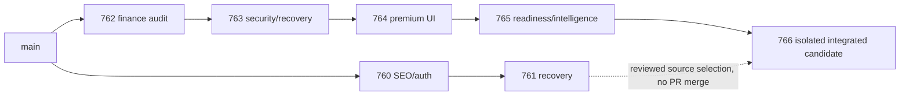

# Consolidated engineering release candidate — HOLD

This master-request follow-up extends draft **#766**, the existing isolated candidate, rather than duplicating its integration work. No existing PR is merged and nothing is deployed. All financial/identity/provider fixtures remain synthetic. The exact final commit, tree, changed-file count and completed GitHub results are recorded in the PR body and GitHub checks; committed reports are pre-publication snapshots, not retrospective exact-head certifications.

## Integration provenance

[Current-head/review inspection](heads-and-reviews.json) records the chain at this audit. #760–#765 heads remain unchanged; all seven PRs remain draft and unmerged. Empty review/inline lists are not independent approval. [Integration evidence](../phase4/integration-resolution.json) documents seven overlapping paths, five conflicts and the imported source manifest. Recovery callback/recovery/reset/shared order form retain #765 behavior; workflow requirements were combined explicitly. [Preservation comparisons](../phase4/preservation.json) cover security, payment, pricing, schema and dependency files. Actual service prices stay unchanged. A later public-registry scan required explicit same-major framework and compatible dependency security updates; see dependency-security.md. Earlier preservation hashes are historical evidence, with the dependency exception documented here.

## Confirmed unfinished defects addressed

1. Existing optional analytics enforcement has been prepared as fail-closed source across browser, client API, auth API and trusted writer. Consent requires trusted authority, version, expiry, revocation, replay consumption and public-activity classification. GPC/DNT and canonical production/environment/dataset exclusions apply. No durable adapter or new collection setting is enabled. See the [privacy audit and activation blockers](../phase4/privacy-audit.md).
2. Public database analytics RPC/table mutation rights could bypass the application gate. The proposed restriction remains outside migrations and **unapplied**. Disposable SQL verifies public-role denial and retained service-writer access. Hosted effective permissions remain unknown; no database compliance claim is made.
3. CI's customer order/billing regressions saw empty synthetic rows because the isolated launcher discarded `DASHBOARD_UPGRADE_AUDIT`. Both process layers now retain only the explicit boolean fixture switch alongside the existing fake-payment mode. Credentials and arbitrary inherited flags remain excluded. The fixture never invokes a real financial RPC.
4. A 36px planner control measured 35.999969px in Chromium. The geometric assertion now tolerates 0.001px numerical error while retaining the 36/44px design requirements and all hit-test/clipping/visibility checks. No UI size or security policy changed.
5. Offline profit reporting now has a reviewable [standalone synthetic dashboard](profit-dashboard.html). It invokes existing integer-paise models, shows signed corrections/losses, wallet liabilities and unknown coverage, and withholds unsupported lifetime/cohort/channel metrics. There is no mounted admin route, live query or analytics collection.

## Verification and known failures

The comprehensive [46-item work register](work-register.csv) includes severity, business impact, root cause, existing status, solution, dependencies, criteria, tests, evidence and PASS/FAIL/BLOCKED/NOT RUN. [Verification snapshot](verification.json) and PR body distinguish scopes, skips and exact tested commits.

Prior exact head `c3b9d7203ada667681217851afb2b9af5b4eae35`, GitHub run43760853095: **428 browser PASS, 68 SKIPPED**, then targeted customer workspace **12 PASS / 2 FAIL** from missing populated fixtures; SQL job PASS. The older local full run was **422 PASS / 6 FAIL / 68 SKIPPED** (timeouts/transport reset), not a clean pass. Corrected workspace checks are rerun, and the final integrated gate is executed again. Passing focused reruns do not erase earlier failures. No retry-only success is presented as a clean full-suite result.

Required source gates include TypeScript, lint, optimized isolated build, units, payment/security/recovery stubs, disposable wallet SQL, finance/funnel fixtures, CRM/notification contracts, SEO route/canonical checks, delayed hydration quantity1000, responsive/axe and native200% zoom. Local timings/layout shifts are lab regressions, not field LCP/INP/CLS/TTFB or database benchmarks. No performance or business uplift is claimed.

## Remaining prerequisites

- Independent source review and human accessibility/screen-reader review.
- Immutable candidate preview and independently corroborated browser/server/direct-DB identities, fixture ownership and absence of production credentials/data.
- Payment/webhook/fulfillment/cron/queue/email/notification egress isolation. An empty Edge Function list proves none of these by itself.
- Separately approved durable consent/preference/retention/classification infrastructure and verified database-ingress restriction before activation.
- Separately approved and reconciled live financial adapters; actual CAC/LTV/retention/channel profit remain unknown.

Read-only QA metadata is [recorded separately](metadata.json); detailed [isolation gaps](../phase4/qa-isolation.md) remain open. A healthy named QA project and environment-variable records do not prove runtime isolation. Authenticated hosted and financial QA remain BLOCKED. No new projects, keys, environment changes, emails, live payments, indexing requests, merges or deployments occurred. **Release HOLD.**

A later registry scan found1 critical/4 high production vulnerable-package groups. The compatible security patch and explicit PostCSS override are documented in [dependency-security.md](dependency-security.md). Patched production scan:0 findings; all-package high/critical gate:0, with one moderate advisory propagated through6 development packages still unresolved. All fresh source groups/lint/build/TypeScript and16 focused plus12 repeated browser checks passed on private Next15.5.29 before publication. Fresh final-head full browser/CI outcomes are updated in the PR body; old426PASS/5FAIL/68NOT RUN local diagnostics remain failed.

A patched diagnostic run was interrupted after130PASS/1FAIL/375NOT RUN when an article keyboard/FAQ audit exhausted30s while also fetching independent related destinations. Related link attachment remains asserted at both viewports;17 unique destination-status checks now run independently with bounded same-origin redirects. FAQ keyboard, content, canonical/schema and30s per-test deadlines stay unchanged. The corrected19-case subset passed; final full coverage is524 cases.

## Catalog rendering correction

A fresh isolated production build reproduced500 on four generic service URLs when a no-store live-catalog read conflicted with static/fallback rendering. The generic route now explicitly renders per request, consistent with the directory. Existing price/availability functions, URLs, canonicals, robots policy, server-side order pricing and provider settings remain unchanged. Four valid routes return200 with the same canonical; an unknown slug remains404. This is local synthetic evidence, not an assertion that production was affected or fixed. See [runtime diagnostics](catalog-runtime-diagnostic.txt), [HTTP proof](catalog-http-proof.json), [build](catalog-build.log) and [10-case target](catalog-fixed-browser.log).

Freshness means request-time catalog work; hosted latency/capacity remains unverified. CTA checks target the existing main landmark rather than header/footer links. Two independent hero/login keyboard journeys now retain separate30s budgets. A single SDK transport retry is permitted only for ECONNRESET on observed read-only loopback marketing GETs; auth/API/payment operations and HTTP failures are not retried. Test retries remain0. No assertion, price, auth control or payment behavior is relaxed. Full inventory524.
