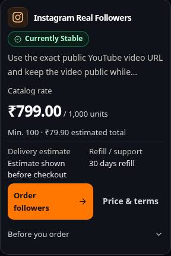
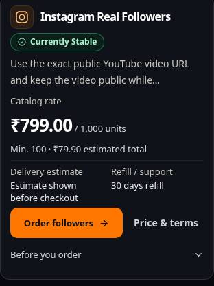

# PR764 — full-CI regression follow-up

Date: 15 November 2026 (Asia/Calcutta). Release remains **HOLD**; draft only. No merge, deployment, live checkout/account, email or indexing activity.

## Original exact-head CI result

At `e2a6ee1a4370aa3ae7a67662bbb10225382e9d73`, [run 43648912528](https://github.com/rushal0803/socialrush-panel/actions/runs/43648912528) completed with PostgreSQL **PASS** and combined smoke/build/unit **FAIL**. TypeScript, build, unit, security and SEO checks passed. Full browser smoke recorded **273 passed, 67 skipped, 5 failed**. Skips are not passes. These failures were outside the original focused 16-case local suite and are not erased by its earlier PASS.

| Failure | Cause | Correction |
|---|---|---|
| Navigation intent fetched `/services?...&_rsc` before click | Newly visible platform/directory Next Links prefetched dynamic route data | Use existing PublicCodeLink to warm immutable code while disabling dynamic directory prefetch |
|320px directory card exceeded 440px | Longer CTA/minimum-total copy wrapped action and metadata rows | Shorten copy to “Price & terms” and “estimated total”; preserve terms, rate unit, minimum quantity and 44px controls |
|1024px directory card exceeded 440px | Same wrapping issue | Same compact copy; no height cap, clipping or test threshold relaxation |
| Guest TikTok order lost platform/service/quantity | Live-fact cards linked to details instead of the existing parameterized order route | Restore orderHref for every Order CTA; protected order review still owns price/availability validation |
| Synthetic signed-in TikTok order lost selection | Same handoff regression | Same fix, exercised against local fake auth only |

No price, auth, server pricing, payment handler, catalog, schema, CSP, security control or provider setting is changed. Live-fact cards still withhold stale static prices; routing to the existing review does not make client price authoritative. Failed tests and the 440px limit are unchanged.

## Verification

Follow-up browser verification: **47 PASS, 1 FAIL** in the 48-case run. The failure was a LinkedIn `page.goto` ERR_ABORTED during the scoped axe case, not an axe violation. The same unchanged case then **PASS** on a one-worker isolated rerun (15.1s), covering all four routes. This is a recovered loading failure, not a claim of 48 clean first-attempt passes. All five original CI regression cases PASS locally. Fresh hosted CI remains **NOT RUN / pending** at publication; see the PR for its live result.

- 237/237 original unit tests PASS.
- 15/15 prior security regressions PASS.
- Explicit TypeScript, isolated optimized build and targeted lint PASS.
- Local measured first-card heights: **429.11px at 320px**, **382.53px at 1024px**, both below 440px. [Raw measurements](ci-followup/card-heights.json).
- Auth/API/payment/security/schema/pricing/catalog source remains byte-identical to #763.
- The first follow-up local runner used 127.0.0.1 while Next redirects use localhost, producing local CSP origin errors. The runner was corrected to the repository's existing localhost authority; the app CSP was not relaxed. Results from that interrupted diagnostic run are not counted as application passes.

Reproduce with the already-built synthetic server:

```sh
node scripts/phase2-isolated.cjs build
node scripts/phase2-isolated.cjs serve 3107
PLAYWRIGHT_BASE_URL=http://localhost:3107 \
NEXT_PUBLIC_SUPABASE_URL=http://127.0.0.1:3001 \
CHROMIUM_EXECUTABLE=/usr/bin/chromium \
npx playwright test --config playwright.ci-followup.config.ts
```

The test configuration runs the existing services-v2, performance-mobile-followup and Phase2 suites, including guest and synthetic signed-in handoffs. It rejects a non-loopback backend. No production account or external provider is used. Full fresh CI must be read at the new head; predecessor failures do not become passes simply because a local patch exists.

React component review: existing immutable-code warming is reused; no new data fetching, hook, effect, render-time mutation or client/server serialization is introduced. Semantic links, visible terms, minimum quantities and target sizes are preserved.

## Visual evidence attribution

The original 26 screenshots remain evidence of initial Phase2 head `e2a6ee1a...`. Their hero/form views remain useful comparisons but are not silently reattributed as new-head captures. These follow-up directory card captures show the current compact copy:

|320px |1024px |
|---|---|
|  |  |

Remaining release gates are unchanged: independently verified hosted client/server/database/payment/worker isolation, authorized synthetic hosted QA and the documented manual accessibility/performance work. Branch automatic deployment remains disabled. Rollback is a reviewed revert of this small follow-up, preserving all financial records and earlier security fixes; reverting reintroduces these UI regressions.
