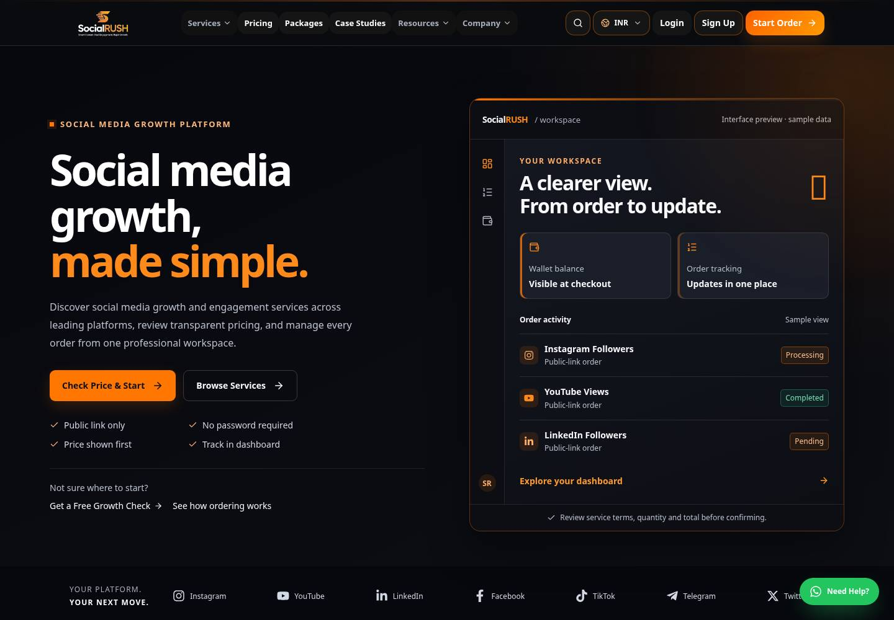
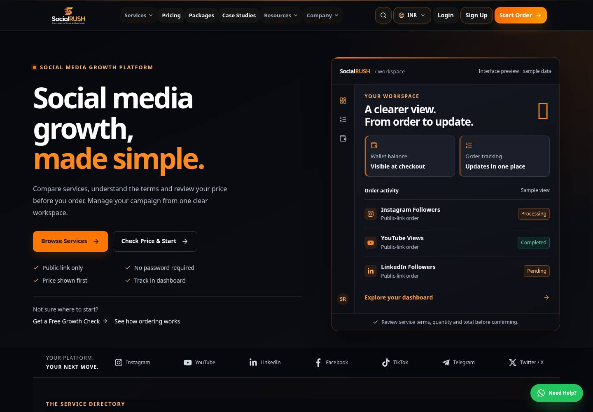
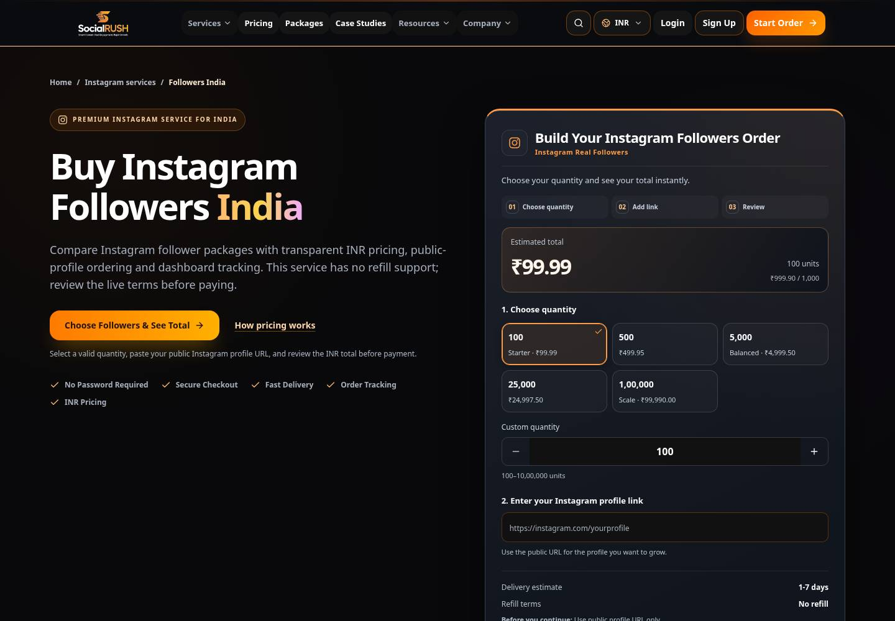
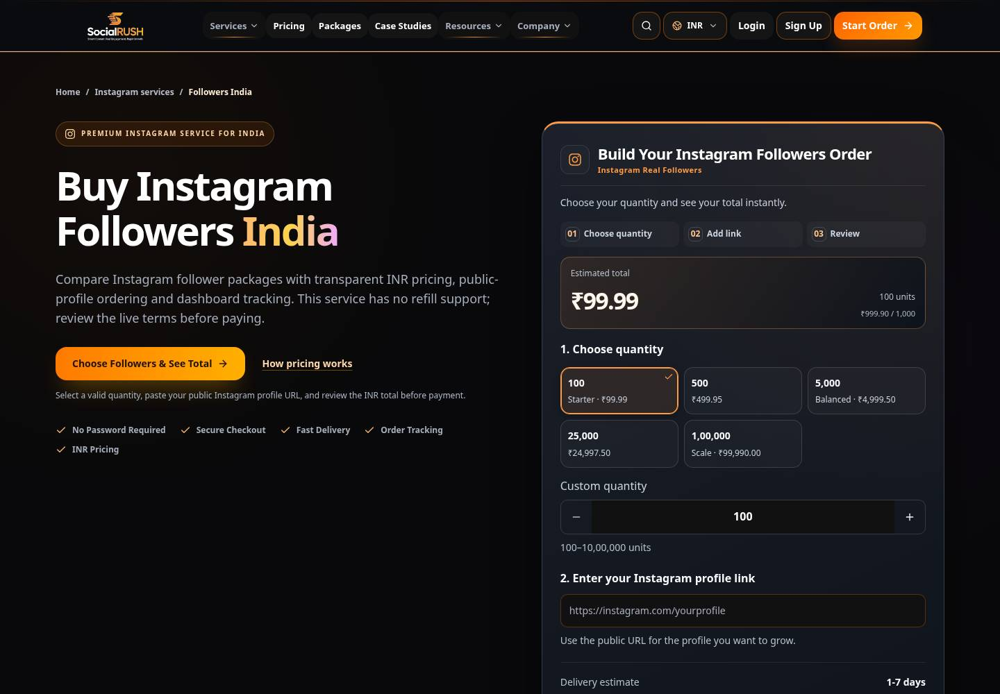
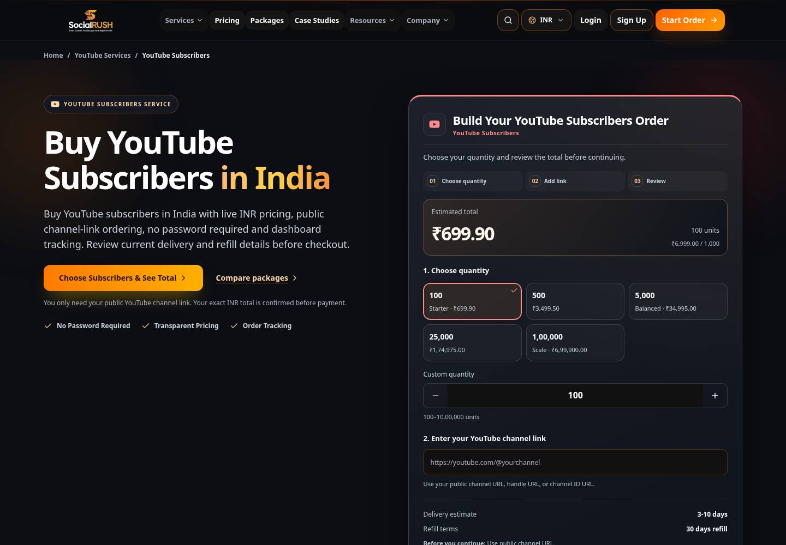
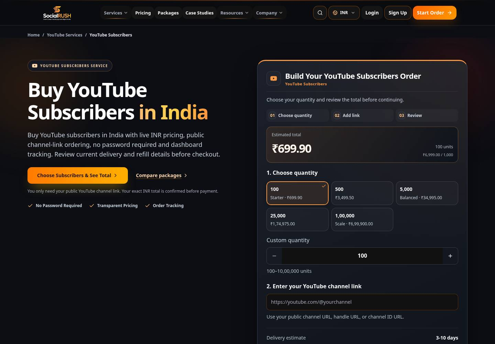
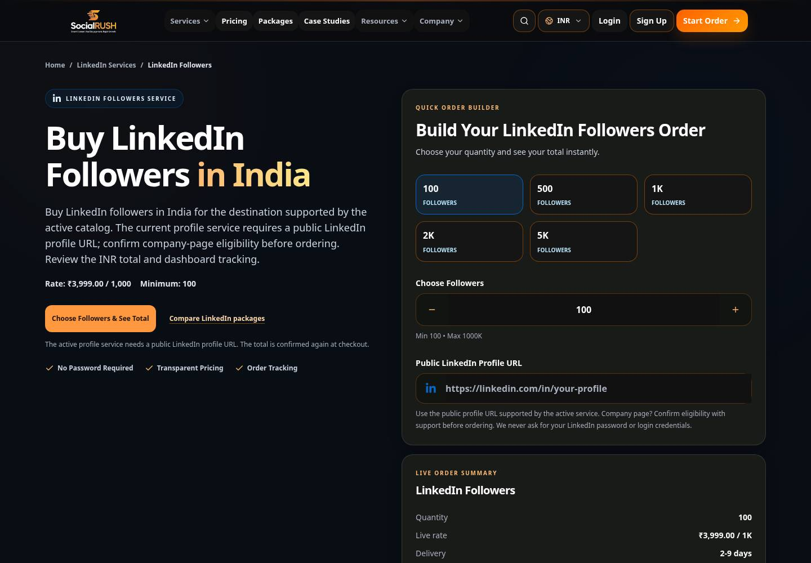
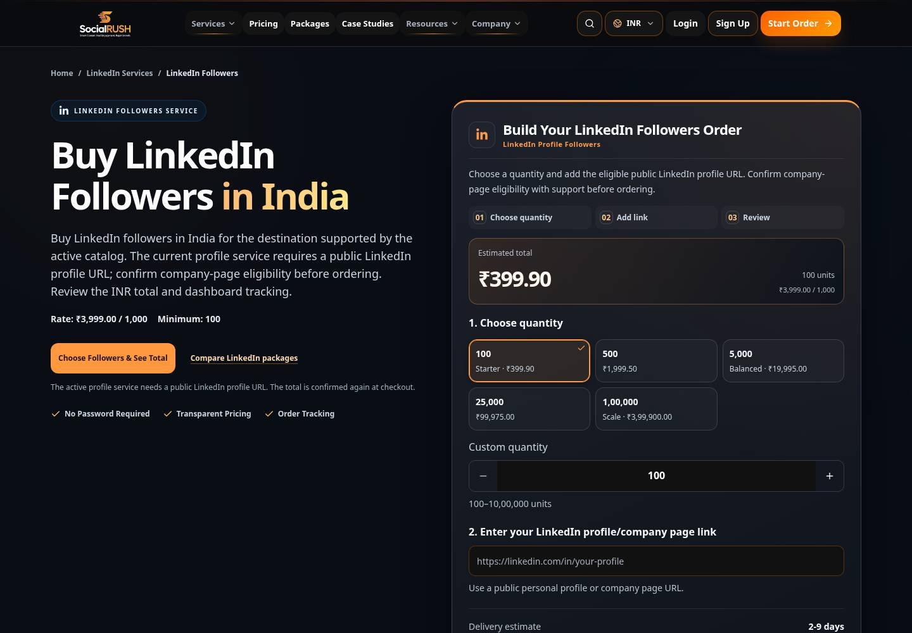
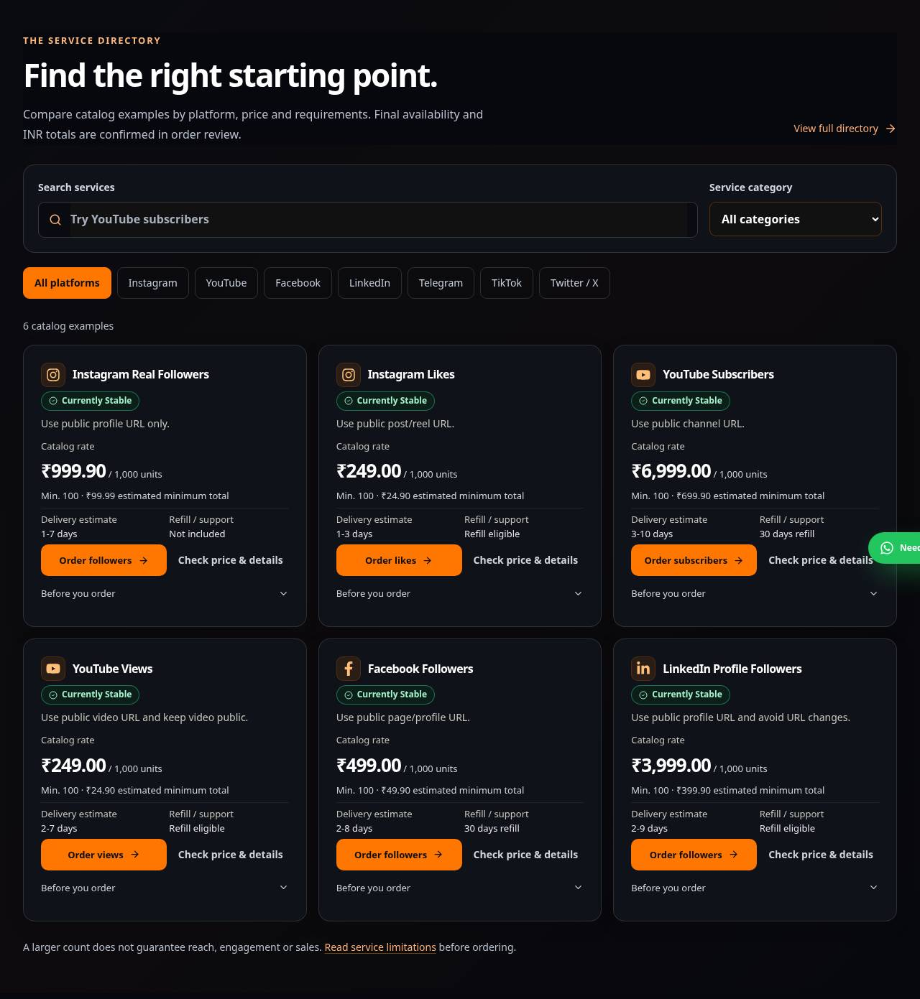
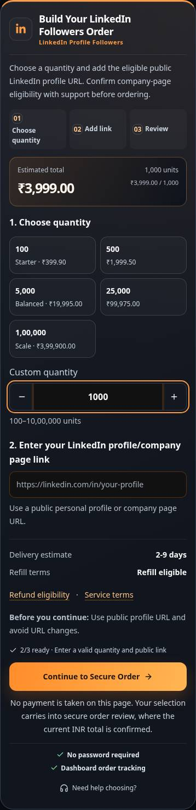

# Local visual review — before and after

Original after captures belong to initial Phase2 head `e2a6ee1a`. See [CI follow-up](ci-followup.md) for later card corrections and new captures. They are not silently reattributed to a newer head.

Before = exact #763 (`94a2b39f`); after = this implementation. Both are local synthetic fixtures, not production/account screenshots. Click any image for its original size. No payment is submitted.

## Home

| Captured viewport | Before | After |
|---|---|---|
| 390px |  |  |
| 1440px |  |  |

## Instagram

| Captured viewport | Before | After |
|---|---|---|
| 390px |  |  |
| 1440px |  |  |

## Youtube

| Captured viewport | Before | After |
|---|---|---|
| 390px |  |  |
| 1440px |  |  |

## Linkedin

| Captured viewport | Before | After |
|---|---|---|
| 390px |  |  |
| 1440px |  |  |

## Discovery and shared form details

These are element crops, not additional viewport assertions. Health/status data is synthetic.

## Narrow screens and native zoom

| Page |320px | Native200% zoom |
|---|---|---|
| Home | [Capture](screenshots/after-home-320.jpg) | [Capture](screenshots/home-200.png) |
| Instagram | [Capture](screenshots/after-instagram-320.jpg) | [Capture](screenshots/buy-instagram-followers-india-200.png) |
| Youtube | [Capture](screenshots/after-youtube-320.jpg) | [Capture](screenshots/buy-youtube-subscribers-india-200.png) |
| Linkedin | [Capture](screenshots/after-linkedin-320.jpg) | [Capture](screenshots/buy-linkedin-followers-india-200.png) |

Native Chrome zoom was set to2 in a disposable profile:1440px CSS viewport became720px, with document scrollWidth720 on every route. See native-zoom.json. This was not simulated by merely resizing the viewport.

Reviewed scope: visual hierarchy, readable public copy, explicit sample labels, destination/price/terms presentation, form focus and selected responsive layouts. The browser suite separately checks interactions, metadata and scoped axe results. These images do not approve all below-fold content, authentic provider behavior, assistive technology or protected hosted checkout.
