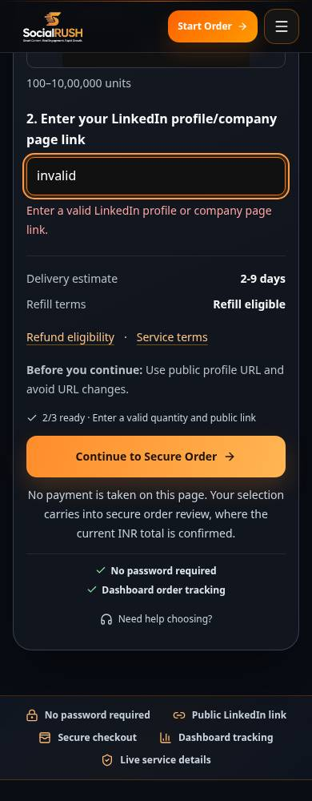
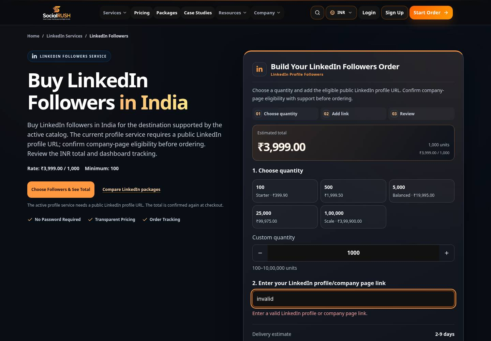

# Navigation, accessibility and performance evidence

## LinkedIn timeout investigation

The [retained #764 follow-up failure](../phase2/ci-followup/browser-48.log) explicitly reports `Test timeout of 30000ms exceeded`, then `page.goto: net::ERR_ABORTED` at the fourth/final LinkedIn audit. Thus the aborted navigation was a consequence of the shared test budget expiring. It is not evidence of an application redirect loop or failed payment/auth state. An isolated original-case rerun previously passed all four routes. The legacy India LinkedIn URL legitimately redirects to `/linkedin-followers`; canonical ownership and redirects are unchanged.

The new test structure gives each of the same four audits its own unchanged default budget. No timeout was increased, assertion removed or automatic retry introduced. Current local suite: **21/21 PASS**, including four independent axe audits, 12 viewport cases, search/quantity/slow hydration and two scripted keyboard cases. Repeating all four axe audits three times with two workers: **12/12 PASS, zero retries**. These results reduce the known cumulative-timeout flake; they do not prove arbitrary load can never cause navigation failures. Source UI/navigation code is untouched.

## Accessibility scope

Source/semantic review confirms labels, native links/selects/FAQ details, inline error association, focus restoration and reduced-motion contexts. Browser evidence retains axe results, semantic trees, keyboard actions, error focus and no-horizontal-overflow checks. The 390/1440 keyboard scenarios type 1000, move focus, submit an invalid public link via Enter and verify focus returns to that field without navigating. Screenshot evidence illustrates those states; it does not certify a full manual audit.

**Human manual keyboard and screen-reader testing: NOT RUN.** This environment exposes no interactive desktop/browser tool and has no Orca/screen-reader executable available. A scripted Tab/Enter sequence, accessibility tree or axe scan cannot substitute for a person using a screen reader. Scoped axe reported no violations; contrast incompletes remain to inspect manually. No WCAG AA certification is asserted.

Required manual session at 390/1440 and 200% zoom: keyboard-only from document start, skip link/header/menu/search/filter and FAQ order, discover services, all form presets/quantity/error summaries, sticky CTA and focus visibility, mobile keyboard obstruction, login-return state and policy links. Repeat with an actual screen reader (e.g. NVDA/Firefox or VoiceOver/Safari), recording announced name/role/value, errors, result-count announcements and task outcomes. Validate composited text/focus contrast, disabled/hover states, motion preference and touch targets. Hosted authenticated cases remain blocked by isolation.

## Performance and regressions

#764 exact-head CI run [43706691399](https://github.com/rushal0803/socialrush-panel/actions/runs/43706691399) is PASS for both core jobs: full browser smoke **278 PASS, 67 SKIPPED**, plus **14 PASS** targeted responsive tests. Its optional performance job is **SKIPPED**, not PASS. #761 has no core CI. Phase 3 current exact-head CI must be read from the new draft PR; these predecessor numbers are not reattributed.

The local scripted keyboard evidence includes raw browser navigation timings on the synthetic optimized #764 build. Redirect, warm-cache, host CPU contention and fixture setup affect them. They are diagnostic lab samples, not comparative CWV gains, field p75, INP or business conversion evidence. There are no new client bundles or production UI imports from the offline intelligence modules. No Lighthouse score, performance-budget certification or paid performance tool was invented.

Field LCP/INP/CLS, real-device/assistive-technology checks, full integrated regression and live conversion measurement remain NOT RUN/BLOCKED as specified in the acceptance matrix. The original Phase 2 gallery/200% checks retain their original-head attribution; this phase does not silently relabel them as current hosted evidence.

## Local keyboard state captures

UI source under test: exact #764 `c77f6bde`; Phase 3 makes no presentation changes. These new captures show synthetic invalid-link focus states, not authenticated hosted screens.

| 390px | 1440px |
|---|---|
|  |  |

See [raw browser semantic/timing evidence](browser-evidence.json), [keyboard rerun](keyboard-rerun.log) and [repeated axe results](axe-repeat-summary.json).
