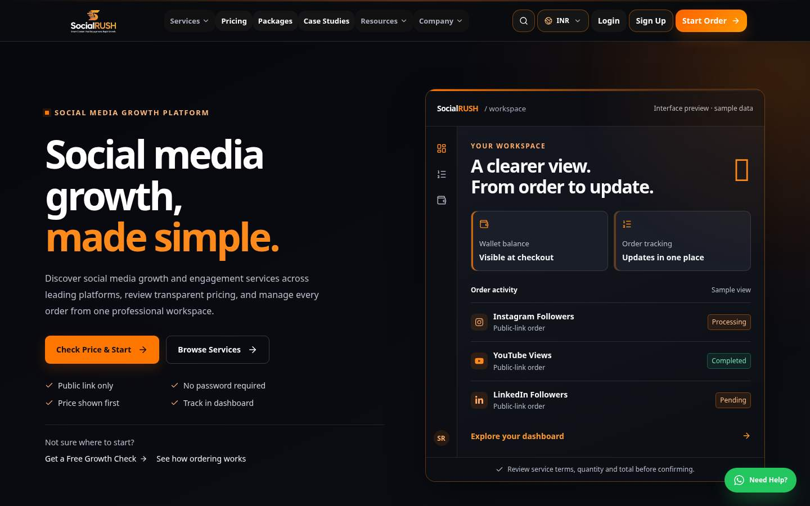

# Verification evidence and limits

Date: 2026-11-15 Asia/Calcutta. Exact published proposal commit is recorded in the draft PR body; all proposal test results below refer to that unchanged code tree. Base is `35fcaf731447a948b69a9ae917b5af596d22711e`; inspected #760 source is `04affabe4287cfa79eab6696ec53825c94714227`.

| Check | Result | Scope |
|---|---|---|
| Candidate baseline targeted unit tests | PASS, 13/13 | Analytics environment guard, recovery source contract, existing daily revenue and goal arithmetic; synthetic/local only |
| Proposal targeted revenue and profit tests | PASS, 16/16 | Existing revenue dashboard + new refund regression, revenue goal engine, six standalone scenario/waterfall tests |
| Candidate TypeScript | PASS | `tsc --noEmit --incremental false`, exit 0 |
| Proposal TypeScript | PASS | Same command, exit 0; installed locked dependencies shared read-only through local symlink; no application execution |
| Diff whitespace | PASS | `git diff --check` |
| Public server HTML | PASS, bounded sample | Home, priority Instagram followers and likes, robots, sitemap, competitor HTTP200; no authenticated account |
| Public browser dimensions | PASS, bounded sample | Home/followers/likes/competitor at 390 and1440; document scrollWidth equals viewport in all eight captures. No claim about all elements, keyboard or checkout. |
| Hosted authenticated scenarios | BLOCKED | Protected preview redirects to Vercel SSO; effective runtime isolation not independently established |
| GSC/GA4/CWV baseline | BLOCKED | GSC Wizard subscription_required; no property-specific metrics available |
| Full application build/regression/security/performance | NOT RUN locally | Current #760 CI metadata is separate evidence. New draft CI must be evaluated independently. |

Run proposal tests from the repository root:

```sh
env -i PATH="$PATH" node --experimental-strip-types --test \
  tests/unit/phase44-revenue-dashboard.test.ts \
  tests/unit/phase46-revenue-engine.test.ts \
  tests/unit/profit-scenario-model.test.mjs
node scripts/profit-scenario-model.mjs
node scripts/profit-scenario-model.mjs --csv
```

No real data: invented order/user identifiers exist only in test memory. No .env was copied into the new worktree. Pure modules do not import Supabase, email or payment providers and never call fetch. The scenario script imports only node:url. No database/RPC/API/provider call was executed by these tests.

The reporting repair changes only subtraction for net revenue. It does not establish that paid orders equal earned revenue or solve matching/pagination/recognition deficiencies. Negative daily values may need an approved isolated chart visual review before any release.

## Public capture scope

Eight captures were taken at 390×900 and1440×900 with ephemeral unsigned-in browser contexts. All mutations, /api calls and third-party requests were intercepted and aborted; only public document/static GETs were allowed. Viewport dimensions and visible h1 are in public-browser-evidence.json. This instrumentation changes runtime behavior and cannot certify dynamic pricing, authenticated UI, analytics collection, TLS configuration or account safety.

Public homepage measured 24,771px tall on mobile and12,398px on desktop in this instrumented session; followers 23,290/12,234px; likes 21,719/11,941px. This supports investigating redundant content/hierarchy, not asserting that page length caused abandonment. CSS motion required scrolling sections into view before full-page capture. Two directly inspected viewport screenshots are retained below; all eight layout summaries are retained. Full-page screenshots were intermediate audit material, not comprehensive visual approval.




These depict existing production pages as read-only observations, not a new preview or the reporting fix. Public capture certificate handling is documented in README.md. No protection or authentication setting changed.

## Final acceptance gates

Keep this proposal and existing #760/#761 draft. No production merge/deploy, indexing, real payment or live customer automation. The new audit branch includes `git.deploymentEnabled[branch]=false`; check Vercel deployment records after publication and do not substitute a newly provisioned preview. A branch opt-out is not Supabase isolation.

For future hosted QA, record exact deployment ID/source SHA, runtime client/server/database identity, QA fixture ownership, worker/provider/notification safeguards, viewport, steps, expected/actual result, trace/screenshots and issue reference. Revalidate if source, base or environment changes. Preserve BLOCKED until independently verified; no owner attestation or READY status replaces this evidence.
